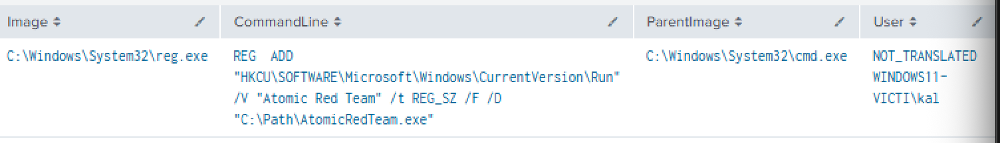
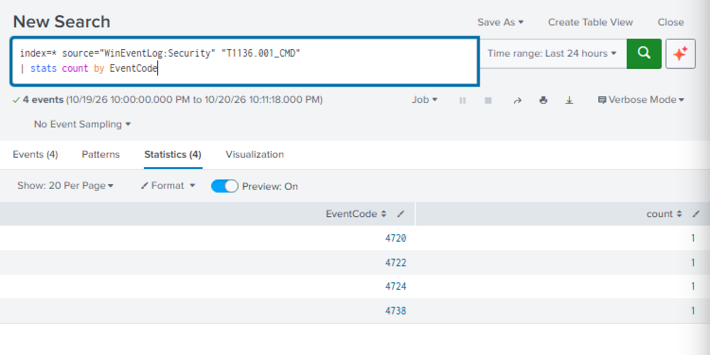
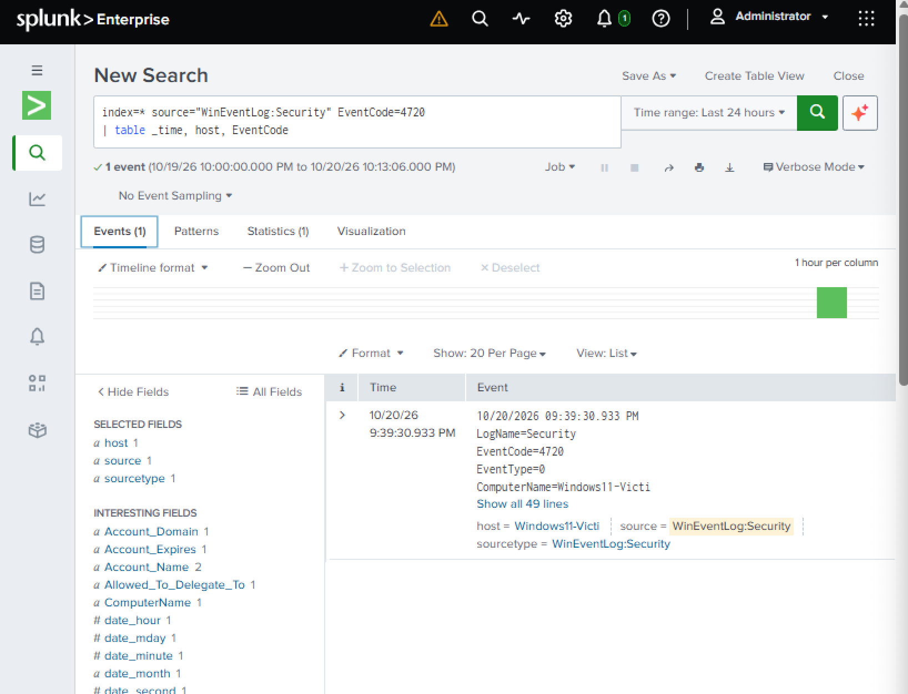
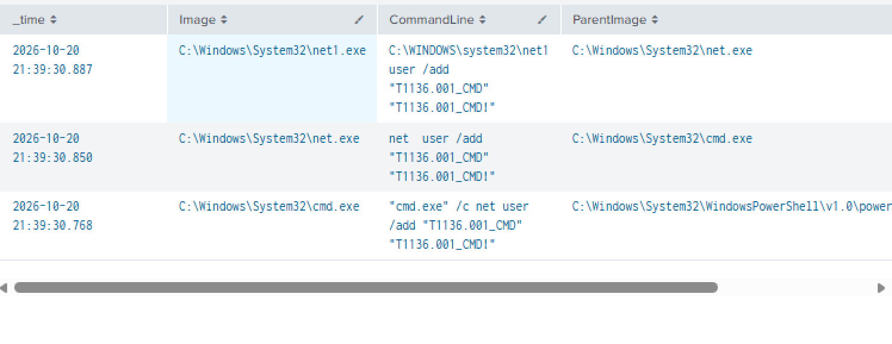
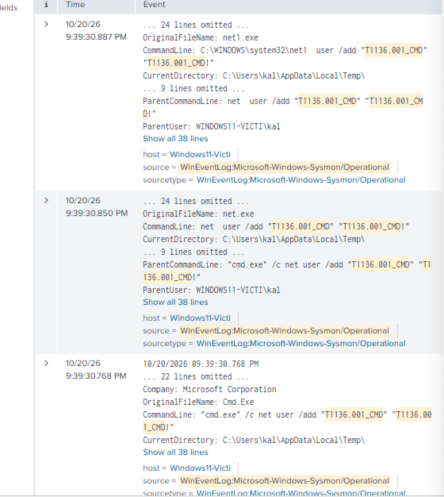
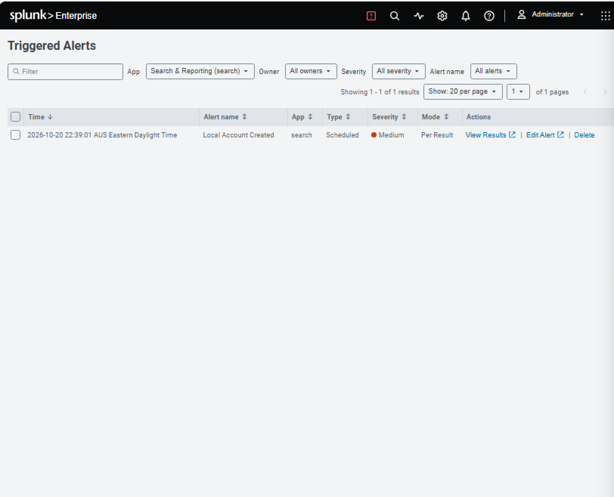
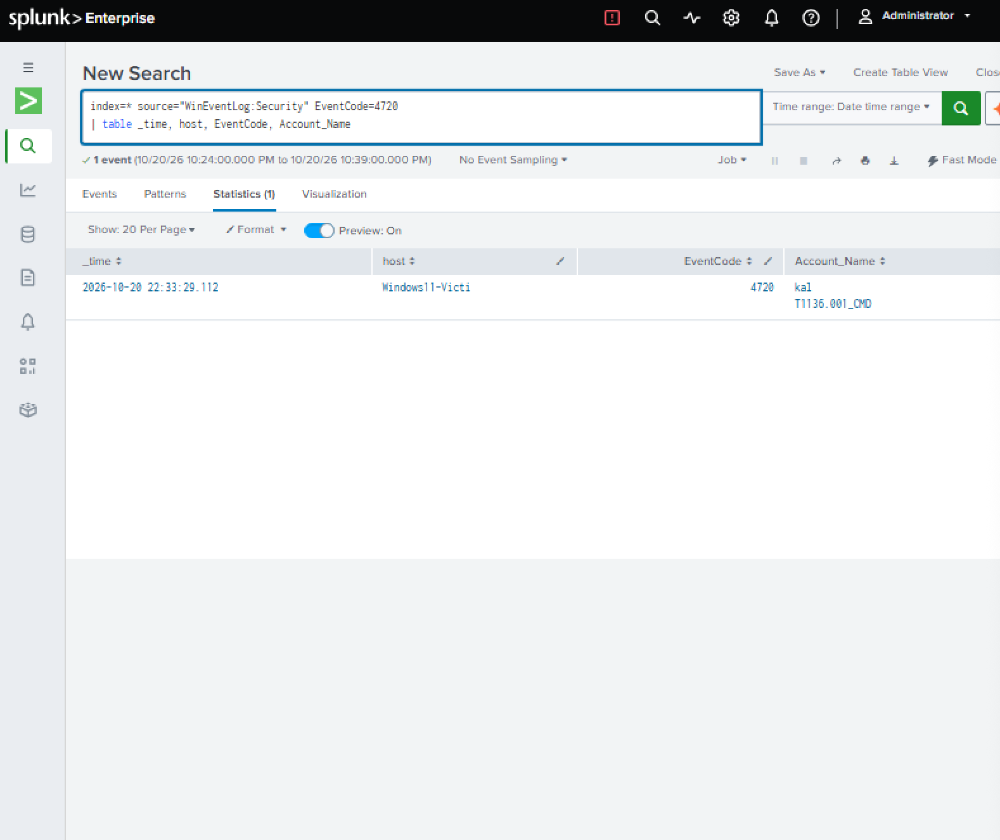
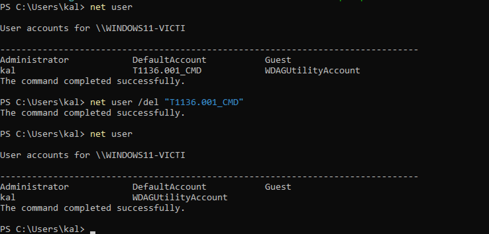

## Incident Report: Detecting Persistence from Telemetry with Sysmon and Splunk (Local Account Creation, Registry Run Key)

**Environment:** Windows 11 Home (ARM64, build 10.0.26200), isolated VirtualBox lab VM
(Windows11-Victim)
**Date:** 20 October 2026
**Techniques:** T1136.001: Create Account - Local Account (Persistence);
T1547.001: Boot or Logon Autostart Execution - Registry Run Keys (Persistence)
**Tools:** Sysmon 15.22 (ARM64 build), Splunk Enterprise 10.4.3, Invoke-AtomicRedTeam

### Summary

My earlier persistence reports found the planted artefact by diffing a baseline taken
before the technique against one taken after. That works when you already suspect a host,
but a SOC mostly works from logs and alerts, because nobody takes a snapshot before an
incident. This exercise repeats the approach the other way round: install Sysmon for
detailed process and registry telemetry, send it to Splunk with the Windows Security log,
run the technique, and find it by searching the telemetry. It ended with a saved Splunk
alert for local account creation that fired.

### Setup

**Sysmon.** Sysmon (System Monitor, from Microsoft Sysinternals) records process
creation with full command lines and parent processes, network connections, registry
changes and more. I used the ARM64 build (`Sysmon64a.exe`) with the community
SwiftOnSecurity configuration (version 74, dated 2021-07-08):

```
.\Sysmon64a.exe -accepteula -i sysmonconfig-export.xml
```

Sysmon 15.22 accepted the older config (schema 4.50 against Sysmon's schema 4.91) and
reported both the driver and the service as started.

**Splunk.** The Sysmon log (`Microsoft-Windows-Sysmon/Operational`) did not appear in
Splunk's Local event log collection list, even after a restart. I added the input directly
in `inputs.conf` and restarted Splunk:

```
[WinEventLog://Microsoft-Windows-Sysmon/Operational]
disabled = 0
```

Events then arrived, with fields such as `Image`, `CommandLine`, `ParentImage` and `User`
already extracted.

### Working with the Noise

A 15-minute window held 1,790 Sysmon process-creation events (EventCode 1), mostly Splunk's
own background processes (`splunk-supervisor.exe` starting its bundled database and proxy
components, for example). Grouping by parent and child process and sorting ascending
shows the rarest pairs first:

```
index=* source="WinEventLog:Microsoft-Windows-Sysmon/Operational" EventCode=1
| stats count by ParentImage, Image
| sort + count
```

Rare did not mean malicious. After excluding Splunk's own install folder, the rare end was
dominated by Microsoft Edge updates, Defender housekeeping and Windows Error Reporting,
all explained by their paths under `Program Files` and `ProgramData`. Telling them apart
relied on path, parent process and user, not on rarity alone.

### Detection 1: Registry Run Key (T1547.001)

I ran Atomic Test T1547.001-1 and searched Sysmon process creation for `reg.exe` touching a
`Run` key, without using the value name:

```
index=* source="WinEventLog:Microsoft-Windows-Sysmon/Operational" EventCode=1 Image="*\\reg.exe" CommandLine="*CurrentVersion\\Run*"
| table _time, Image, CommandLine, ParentImage, User
```

The result was one row: `reg.exe` run by `cmd.exe` as the lab user, with the command line
`REG ADD "HKCU\SOFTWARE\Microsoft\Windows\CurrentVersion\Run" /V "Atomic Red Team" /t REG_SZ /F /D "C:\Path\AtomicRedTeam.exe"`.



I did not confirm the second route, Sysmon EventCode 13 (registry value set), so this
detection is based on `reg.exe` and would miss malware that writes the key directly. I also
did not turn this search into an alert.

### Detection 2: Local Account Creation (T1136.001)

The Atomic tests available for Windows were 4 (command prompt), 5 (PowerShell), 8 (admin
user) and 9 (admin user via .NET). I ran test 4 after checking what it does:

```
Invoke-AtomicTest T1136.001 -TestNumbers 4 -ShowDetails
net user /add "T1136.001_CMD" "T1136.001_CMD!"
```

Windows was already auditing account creation (`auditpol` showed User Account Management
auditing Success).

**Investigation, starting from the clue "a new local account appeared".** The Security log
tells you what and who, and Sysmon tells you how, so I used both.

*Security log.* Searching on the account name returned four events:

| EventCode | Meaning |
|---|---|
| 4720 | A user account was created |
| 4722 | The account was enabled |
| 4724 | An attempt was made to set the account's password |
| 4738 | The account was changed |



The 4720 event shows the creating account (`kal`) and the new account (`T1136.001_CMD`).
There was no 4732, so the account was never added to the Administrators group, and no 4624,
so it never logged on.



*Sysmon.* Pivoting on the account name in Sysmon showed the full process chain:

```
index=* source="WinEventLog:Microsoft-Windows-Sysmon/Operational" "T1136.001_CMD"
| table _time, Image, CommandLine, ParentImage, User
```

```
21:39:30.768  powershell.exe starts cmd.exe /c net user /add "T1136.001_CMD" "T1136.001_CMD!"
21:39:30.850  cmd.exe starts net.exe user /add ...
21:39:30.887  net.exe starts net1.exe user /add ...
21:39:30.933  Security log: 4720 (account created)
21:39:30.989  Security log: follow-up account events
```





Observations an analyst would record:

- PowerShell started `cmd.exe`, which started `net.exe`, which started `net1.exe`. `net.exe` is a thin
  wrapper that calls `net1.exe`, so every `net` command appears twice and a detection on
  the command line needs to allow for that.
- The whole chain ran in about 120 milliseconds, which points to a script or tool, not a
  person typing.
- The password is in the command line in clear text, and Sysmon recorded it.
- `OriginalFileName` records the program's real name inside the file, so a renamed copy of
  `net.exe` would still be identified.
- The commands ran from the user's `Temp` directory.
- The Security log `Subject` identifies the account that acted, not the person. In a real
  incident, stolen credentials would show the same account name.

**Conclusion of the investigation.** A local account was created by the lab user through
PowerShell, `cmd.exe` and `net user /add`, with the password visible in the command line, and
it was never added to a privileged group or used to log on. Mapped to ATT&CK, this is
T1136.001, persistence.

### Alert

The most reliable single signal for account creation is the Security log 4720 event,
because it is written whichever tool creates the account, while a Sysmon search on
`net user` would miss PowerShell or API-based creation:

```
index=* source="WinEventLog:Security" EventCode=4720
| table _time, host, EventCode, Account_Name
```

I saved this as an alert named `Local Account Created` (trigger when the number of results
is greater than 0, for each result, throttled by host, severity Medium, action Add to
Triggered Alerts).

My first version was a real-time alert. It did not fire when I created an account, and I
did not establish why. I switched it to a scheduled alert, which did fire.





An important caveat: the scheduled alert fired on an account I had created a few minutes
before saving it, because a scheduled search looks back over its time window (the results
show a 15-minute window). So this shows that the detection logic and alert work, but it is
not a clean measurement of how quickly the alert reacts to a brand-new event, and I am not
claiming a response time.

### Cleanup

I removed the artefacts with Atomic Red Team's cleanup flag, then verified. Before the
account was removed, `net user` listed it, and afterwards it did not:

```
Invoke-AtomicTest T1136.001 -TestNumbers 4 -Cleanup
Invoke-AtomicTest T1547.001 -TestNumbers 1 -Cleanup
```



### Limitations

- Atomic Red Team's tests are simplified stand-ins for real attacker behaviour, and the
  environment is a single isolated VM.
- Only test 4 (command prompt) was run. Whether the same detection catches the PowerShell,
  admin-user and .NET variants is untested.
- The Run key detection relies on `reg.exe` and has no alert.
- The older SwiftOnSecurity configuration (2021) is not tuned for this environment.
- The scheduled alert's response time was not measured (see above).

### Conclusion

This exercise covered deploying Sysmon on ARM64 Windows and sending its events to Splunk,
filtering telemetry noise, investigating a new local account across two log sources with
a clear timeline, and saving an alert that fired. It also showed the difference between
finding an artefact by comparing baselines and detecting it from telemetry.
